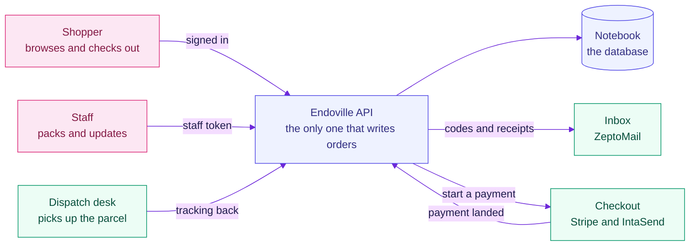
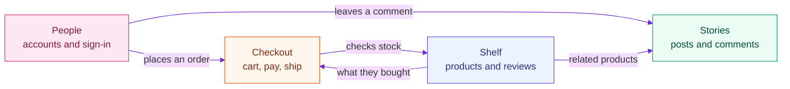
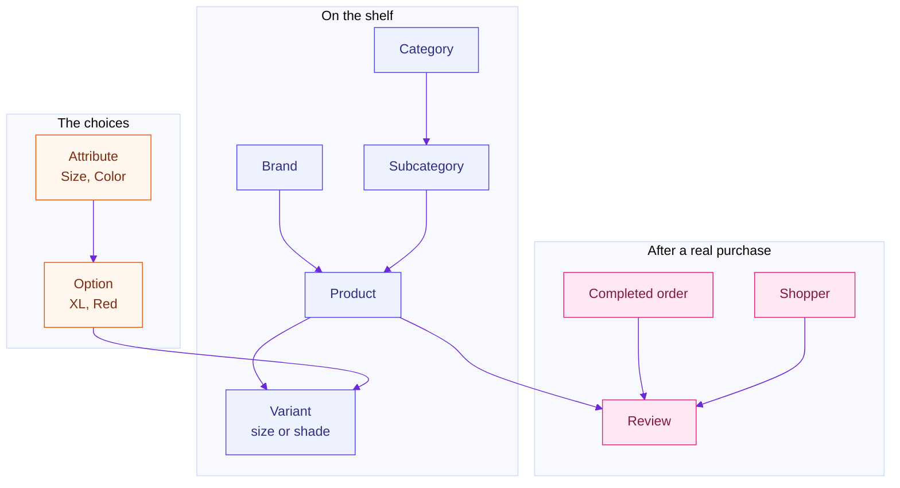
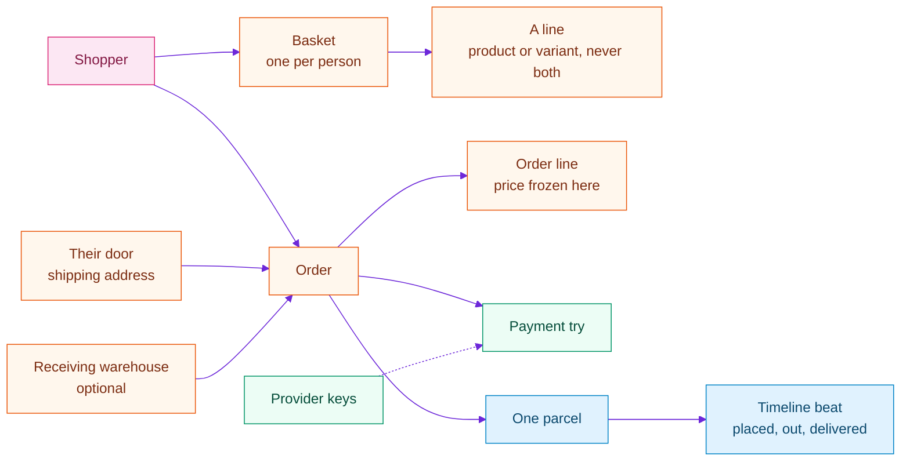
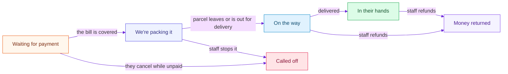
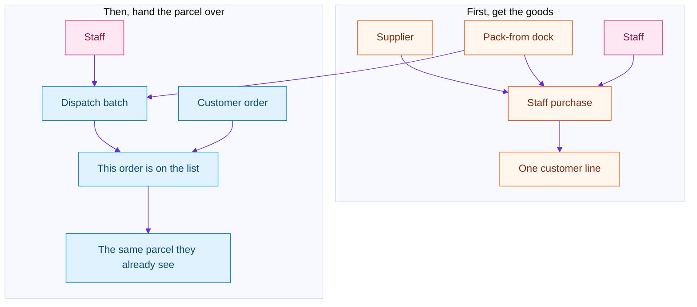
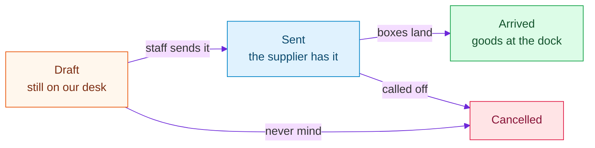
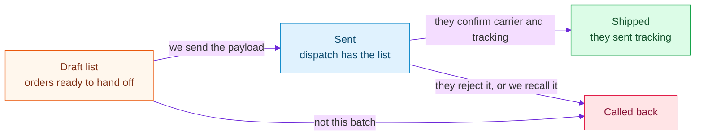
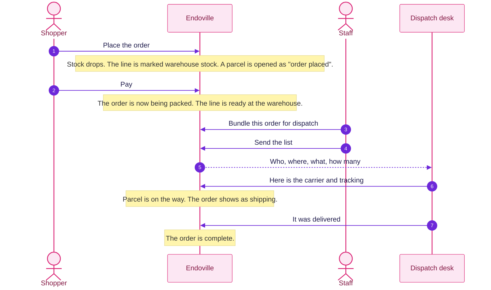
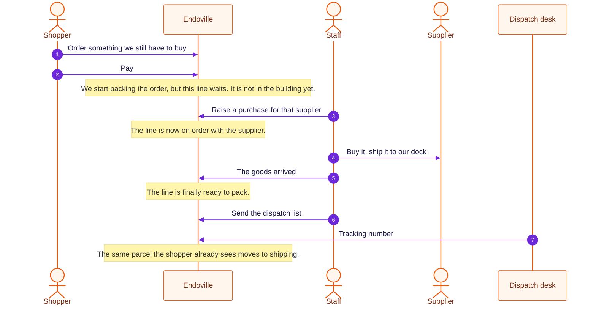

# Architecture

This page is a map of the backend. A shopper can register, browse, keep a cart, place an order, and pay. Staff look after the catalog, payments, and shipping. Each order has one parcel, and that parcel is what the shopper tracks.

The first half is what the API does today. The second half is the purchasing and dispatch handoff we still need to add. Those new records sit on the order line and the parcel you already have. They do not replace them.

## System context



The API is the only writer of orders, payments, and shipments. The storefront never updates stock or shipment status itself. The dispatch site receives an export of ready orders and later confirms carrier and tracking. That confirmation is written onto the existing `Shipment`.

## Runtime

| Piece | Role |
|---|---|
| Django 6 + Django REST framework | HTTP API and admin |
| SimpleJWT | Access and refresh tokens. Access lifetime is 3 hours, refresh is 7 days |
| `users.CustomUser` | Auth user. Login identifier is email or phone, not a username |
| SQLite `src/db.sqlite3` | Database configured in `core.settings` |
| django-allauth | Google social login |
| django-import-export | Admin import and export on catalog and order models |
| django-background-tasks | Repeating abandoned-cart reminder job |
| ZeptoMail | OTP, order confirmation, and cart reminder email |
| django-cors-headers | Storefront origins |

URL mount points in `core.urls`:

| Path | App |
|---|---|
| `/` | Redirects to `/docs/` |
| `/docs/` | Built documentation from `src/site` |
| `/admin/` | Django admin |
| `/api/users/` | Accounts, OTP, login |
| `/api/blogs/` | Posts and comments |
| `/api/products/` | Catalog |
| `/api/orders/` | Cart, orders, payments, shipments, staff tools |

Default permission is authenticated. Catalog and blog reads override that and are public. Writes on those resources are staff-only, except product reviews and blog comments, which a signed-in customer can create under extra rules.

## Apps



| App | Owns | Depends on |
|---|---|---|
| `users` | `CustomUser`, `OTP` | nothing in the other apps |
| `products` | Catalog, variants, reviews, currency | `users` for the review author, `orders.Order` for a verified purchase |
| `blogs` | Authors, posts, comments | `users` for comment authors, `products.Product` for related products |
| `orders` | Cart, checkout, payment, shipment | `users`, `products` |

`orders` is the commerce aggregate. Fulfillment records for supplier purchasing and dispatch batches belong in `orders`, because they exist only to move a paid customer order to the existing shipment. The product only stores which mode a listing uses.

## Identity

`CustomUser` (`AUTH_USER_MODEL`) has no username. Email and phone are each unique and nullable, and at least one is required. Accounts with an `@endovillehealth.com` email are created as staff.

`OTP` is a six-digit code for activation or login. A new code replaces the previous one for that email or phone. Verification allows three failures, then the code is rejected. Expiry comes from `OTP_EXPIRY_MINUTES` at send time. The model helper `create_otp` uses a five-minute window.

Login returns a JWT pair. Google login uses allauth and the same user model. `is_staff` marks a staff account. A Django admin is `is_superuser` and has every role. Other staff have Django groups ticked as roles: `Orders`, `Shipping`, `Stock`, and `Manager`. A new staff account from an `@endovillehealth.com` email starts with `Orders`, `Shipping`, and `Stock`. An admin adds a staff user at `POST /api/users/staff/` and sends only the roles that person should have. Staff read customers and their shipping addresses at `GET /api/users/customers/`. Staff accounts are left out of that list. Repeated copies of one address are returned once.

Commerce permissions:

- `Orders`: all orders, line changes, payments, refunds, and payment credentials. Can place an order for a customer.
- `Shipping`: shipments, shipment events, and reading every order and shipment.
- `Stock`: create and edit products and variants.
- `Manager`: warehouse create and update. Other staff can read a warehouse and cannot change it.
- An admin passes every role check.

## Catalog



`Currency.usd_rate` means how many units of that currency equal 1 USD. One row is `is_primary`. Stripe FX quotes refresh `usd_rate` for every active currency except USD, so a shopper price matches the amount checkout charges. `rate_synced_at` is the time of that quote. Order totals are stored in the primary currency. A payment stores the `usd_rate` it was charged with, and `Order.recalculate_is_fully_paid` converts that payment back with the stored rate.

`Product` is the listing: name, description, brand, price, cost price, optional stock, unit weight in grams (default 1), optional SKU, unique barcode, images, SEO slug, featured flag, and `is_cancelled`. `track_stock` defaults off. Checkout ignores stock until a stock number is set on create or edit, which turns `track_stock` on. Sending `track_stock: false` leaves the number unused. `supplier_order_urls` is a list of http(s) links staff use to buy that product from a supplier. Public responses omit `cost_price`, `supplier_order_urls`, and `revenue`. `quantity_sold` is public. It and `revenue` are stored from order lines and move with a sale, a removed line, or a cancelled or refunded order. `revenue` is the sum of those line totals in the primary currency, and only staff receive it. `avg_rating` and `review_count` are denormalized from reviews that are not flagged.

`Brand` and `Category` store `products_count` and `products_sold` so a list does not count rows on each request. `products_count` goes up or down when a product is linked or unlinked. A product in several subcategories of one category counts once. `products_sold` is the `quantity_sold` of the products linked there now. Placing a line adds the quantity. Removing or replacing a line, or cancelling or refunding the order, takes those units back off. Moving a product to another brand or category, or deleting it, moves that product's `quantity_sold` with it.

`ProductVariant` is the purchasable combination of variation options. Price and cost override the product when set. Stock does not. A variant sale reduces that variant's stock only, and only when the variant's `track_stock` is on. Barcode is unique when present.

`ProductReview` is one review per user per product, rating 0–5. Create is allowed only when the user has a completed, fully paid order with a confirmed line for that product. Unavailable and replaced lines were not shipped, so they cannot be reviewed. The order link is stored on the review. Staff cannot delete a review. They flag it as `PROFANITY`, `MALICIOUS`, or `OTHER`. A flagged review is hidden from other customers and dropped from `avg_rating` and `review_count`. Staff and the author still see it, including `is_flagged`, `flag_reason`, and `flagged_at`. The author cannot change that flag. Staff can clear it.

Public reads, staff writes: `StaffWriteReadOnly` on products, variants, brands, categories, currencies, and variation tables.

### Listing mode to add on `Product`

Each listing needs a fulfillment mode so staff know whether paid units are already at a shipping location or must be bought.

Add these fields to `products.Product`:

| Field | Type | Meaning |
|---|---|---|
| `fulfillment_mode` | `WAREHOUSE` or `SUPPLIER` | Default `WAREHOUSE`, so current products keep today's behavior |
| `supplier` | FK to `orders.Supplier`, null | Required in practice when mode is `SUPPLIER` |
| `shipping_location` | FK to `orders.ShippingLocation`, null | Where this product is packed and dispatched from |

Do not put this on the variant unless a later listing truly splits one product across modes. A variant keeps its own stock and does not draw from the product.

`stock` stays "units available to sell" when `track_stock` is on, and checkout decrements that shelf. For `WAREHOUSE`, that number is on-hand at `shipping_location`. For `SUPPLIER`, it is available-to-promise: the customer can buy it, and staff must raise a supplier order for the quantity sold. Checkout does not grow a second stock counter. When `track_stock` is off, checkout does not read or change the number.

## Content

`blogs.Category` and `blogs.Subcategory` are separate from the product taxonomy. `Author` is a byline, not a `CustomUser`. `Post` has slug, excerpt, SEO fields, `is_published`, `views`, and optional `related_products`. `Comment` is written by a `CustomUser` on a post.

Reads are public. Creating or editing authors, categories, and posts is staff-only. Comments can be created by an authenticated user and changed by the author or staff.

## Commerce as implemented



### Cart

One `Cart` per user. `CartItem` is either a product or a variant, never both, and unique per cart. Sync replaces the line set and clears `last_reminder_at`. Clear deletes lines the same way. The cart response includes `weight_grams`, `shipping_fee`, and `shipping_fees` for the lines currently in the basket, using the same schedule as checkout. `shipping_fee` is set when the shopper sends `country`, when only one country is configured, or when no countries are configured and the fee is the base fee. Otherwise it is null and `shipping_fees` lists each country.

Abandoned-cart emails go out at 12, 24, and 48 hours of inactivity, one step on each run. `last_reminder_at` stays empty until an email succeeds, then stores the cart's last activity plus that step. A background task runs on `ABANDONED_CART_REMINDER_BG_INTERVAL_SECONDS` (default 1800). Placing an order clears the cart.

### Order

`Order.status`:

| Status | When it is set |
|---|---|
| `PAYMENT_PENDING` | Created, or the bill is no longer covered while the order is still being processed |
| `PLACED` | Legacy. A covered bill moves it to `PROCESSING` |
| `PROCESSING` | The bill is covered and the parcel has not left. This is the order being processed |
| `SHIPPING` | Shipment becomes `DISPATCHED` or `OUT_FOR_DELIVERY`. The order is being shipped |
| `COMPLETE` | Shipment becomes `DELIVERED` |

`is_fully_paid` is the covered-bill fact. It is derived from payments and completed refunds and is not writable. It stays true through processing, shipping, and completion while the money still covers `total`. `PROCESSING` is that fact before the parcel leaves. A later shortfall moves `PROCESSING` back to `PAYMENT_PENDING` and leaves `SHIPPING` and `COMPLETE` on the parcel. Changing `shipping_fee` recalculates `total` and this paid state.
| `CANCELLED` | Customer may cancel only their own unpaid order. Pending payments are cancelled with it |
| `REFUNDED` | Every received payment has a completed refund record. Staff can set this status to write those refunds. The order stays `REFUNDED` only after every held payment is covered, and that check runs once the refund rows exist. Recording the refund does not call the payment provider |

Money fields `subtotal`, `shipping_fee`, and `total` are snapshotted on the order. `shipping_fee` is USD. Checkout sets it from the admin shipping schedule: a base fee plus the destination country's USD-per-kilogram rate times the products' weight. Weight is each line's `unit_weight` in grams, and a variant line uses its product. A request `shipping_fee` is ignored. With no country rates saved, every destination pays only the base fee. Once any country is saved, checkout to a country that is not on the list is refused. An admin replaces the schedule at `PUT /api/orders/shipping-rates/`. Anyone can read it and quote a basket at `POST /api/orders/shipping-rates/quote/`. The `Orders` role can still change the stored fee on an order after it is placed. `ShippingAddress` is its own row copied at checkout, not a live profile address.

`Warehouse` is the receiving address a placed order is shipped to. It is not the customer’s delivery address, and it is not created automatically. Staff read it at `/api/orders/staff/warehouses/`. A manager or admin creates and edits the address there. `code` is set on create and then fixed. Only one warehouse stays `is_active`. Checkout stores that active warehouse on the order. When none is active, `Order.warehouse` is null. Orders already placed keep the warehouse they were given. Customers see that nested address on the order and cannot edit the warehouse record.

`OrderItem` stores `product_name`, `variant_description`, `barcode`, `quantity`, `unit_price`, and `line_total` so catalog edits do not rewrite history. `product` and `variant` foreign keys are nullable and use `SET_NULL`.

Checkout in `CreateOrderSerializer.create` is one transaction: address, order, stock decrement, line snapshots, totals, then `Shipment` plus a first `ShipmentEvent` of `ORDER_PLACED` / "Order placed".

### Payment

`PaymentCredentials` holds the active key pair per provider and environment (`sandbox` or `live`). The secret is encrypted with a Fernet key derived from `SECRET_KEY`. Only one active row is kept per provider and environment.

`OrderPayment` is an attempt: provider, amount, currency, checkout URL, provider ids, and raw response. `transaction_id` is optional. Staff may omit it, send `null`, or send an empty string, and the stored value is `null`. A non-empty id must be unique. It is included on staff payment responses and on each payment inside an order. A new payment is refused when the order is `CANCELLED` or `is_fully_paid` is already true. Returning money is an `OrderRefund`. Any payment or refund change recomputes `is_fully_paid`. A covered bill moves `PAYMENT_PENDING` or `PLACED` to `PROCESSING`. A shortfall moves `PROCESSING` back to `PAYMENT_PENDING`. The order confirmation email is sent on commit when a payment first becomes `completed`.

`OrderRefund` is the record for returning money from a completed payment. Every refund stores a `reason` and a unique `transaction_id`. Staff send both when they create one at `/api/orders/staff/refunds/` for a cancelled order, for the full balance or a smaller amount. A line change writes the reason from that change and assigns a transaction id. Payments themselves are not edited or deleted. Status `initiated` sets the payment to `refund_initiated` while any refund is still open. The order still counts that money as paid. A completed refund is subtracted from the paid sum. When completed refunds cover the payment, its status becomes `refunded`. When every received payment on a cancelled order is `refunded`, the order becomes `REFUNDED`. Orders include `refunds` next to `payments`.

Staff changes to an order status, a line, a payment, a refund, or a product or variant price are stored on `StaffChangeLog`. The row keeps the staff user, a short summary, and the before and after values. Shopper checkout and provider callbacks are left out, because those requests have no staff user. Staff read the log at `GET /api/users/staff-changes/`.

Each order line starts as `pending`. Staff confirm it (`POST /api/orders/orders/{id}/items/{item_id}/confirm/`), mark it `unavailable` (`.../unavailable/`, and `.../remove/` does the same), or replace it (`.../replace/`) while the order is `PAYMENT_PENDING`, `PLACED`, or `PROCESSING`. An unavailable line stays on the order, drops out of `subtotal` and `total`, returns its stock, and no longer counts as a sale. A replacement keeps the original line as `replaced` and adds a `confirmed` line for the product that will ship. The customer sees both, including `availability_note` when staff left one. The order cannot move to `SHIPPING` or `COMPLETE` until every line is confirmed, unavailable, or replaced, and at least one line is confirmed. A lower total on a paid order writes an initiated partial refund for the difference. A review is allowed only for a `confirmed` line on a completed, fully paid order.

Providers in code: `intasend`, `stripe`, `pesapal`, `cash`, `other`. Stripe completion is the webhook `POST /api/orders/payments/stripe/webhook/`. Staff and the order owner can also call `POST /api/orders/payments/{id}/check-status/` while a Stripe checkout is still pending. That reads the Checkout Session and marks the payment completed when Stripe says it is paid. Creating another payment first checks those open Stripe sessions, and refuses the new payment when one of them has already covered the order.

### Shipment

One `Shipment` per `Order`. Status values: `ORDER_PLACED`, `DISPATCHED`, `OUT_FOR_DELIVERY`, `DELIVERED`. Carrier, tracking number, tracking URL, and delivery timestamps live here.

`Order.status` and `Shipment.status` stay on the same step. `DISPATCHED` or `OUT_FOR_DELIVERY` keeps the order at `SHIPPING`. `DELIVERED` keeps it at `COMPLETE` and fills `delivered_at` when that timestamp is empty. Moving the order to `SHIPPING` or `COMPLETE` moves the parcel the same way, and moving either one back to placed or to `PAYMENT_PENDING` / `PROCESSING` moves the other back with it. `OUT_FOR_DELIVERY` is kept when the order stays on `SHIPPING`. Cancelled and refunded orders leave the parcel where it is. Entering `SHIPPING` or `COMPLETE` is refused while any line is still `pending`, or when the order has lines and none of them are `confirmed`. A save that does not write `status` does not apply these changes.

`ShipmentEvent` is the customer timeline: status, message, location, `occurred_at`. Saving an event whose status is `DISPATCHED` or `OUT_FOR_DELIVERY` moves the shipment forward to that status and sets the order to `SHIPPING`. A `DELIVERED` event moves the shipment to `DELIVERED`, records `delivered_at` when it is empty, and sets the order to `COMPLETE`. Events only move a shipment forward. The order and the parcel still follow the rules above once the shipment status changes.

Customers read shipments for their own orders. Staff update them at `/api/orders/staff/shipments/` and append events at `/api/orders/staff/shipment-events/`.



## Rules the fulfillment addition follows

1. Customer tracking remains one `Shipment` and its events. Dispatch confirmation fills `carrier`, `tracking_number`, `tracking_url`, and status `DISPATCHED`. It does not invent a second tracking model.
2. An order is exported only when every line is ready to pack. A half-ready order stays in `PROCESSING`. That matches one shipment per order. Split shipments would require changing `Shipment.order` from one-to-one to foreign key, which this design does not do.
3. Supplier purchasing and dispatch batches are staff-only and live under `/api/orders/staff/`, same as shipment updates.
4. Line snapshots stay immutable for name, barcode, and price. Fulfillment status is operational and may change after checkout.
5. Catalog mode is copied onto the line at checkout. Later edits to the product do not rewrite open orders.
6. Customers do not see supplier orders, cost, or batch ids. They see the order and the shipment timeline they already see.

## Fulfillment structure to add



### `orders.Supplier`

Who staff buy from.

| Field | Notes |
|---|---|
| `name` | Required |
| `email`, `phone` | Optional contact |
| `notes` | Optional |
| `is_active` | Default true |

### `orders.ShippingLocation`

The later pack-from location for supplier goods and dispatch pickup. This is not the customer's `ShippingAddress`, and it is not the `Warehouse` already used as the order’s receiving address.

| Field | Notes |
|---|---|
| `name` | Required, unique |
| `code` | Short code used in exports, unique |
| `contact_name`, `phone`, `email` | Optional |
| `address_line_1`, `address_line_2`, `city`, `state`, `postal_code`, `country` | Where the supplier ships stock, and where the dispatch site collects parcels |
| `is_active` | Default true |

### Fields added to `orders.OrderItem`

Copied at checkout from the product (variant's product).

| Field | Notes |
|---|---|
| `fulfillment_mode` | `WAREHOUSE` or `SUPPLIER` |
| `fulfillment_status` | See below. Default `PENDING` |
| `supplier` | FK, null. Set for `SUPPLIER` lines |
| `shipping_location` | FK, null. Set from the product |

`fulfillment_status`:

| Status | Meaning |
|---|---|
| `PENDING` | Paid or not, no supplier order yet, not in a dispatch batch |
| `SUPPLIER_ORDERED` | Included on a supplier order that is not yet received |
| `AT_WAREHOUSE` | Ready to pack. Warehouse lines jump here once the order is fully paid. Supplier lines jump here when the supplier order is received |
| `EXPORTED` | Included on a dispatch batch that has been exported |
| `DISPATCHED` | Dispatch site confirmed this order shipped |
| `CANCELLED` | Order line will not be fulfilled |

Warehouse lines stay `PENDING` until `Order.is_fully_paid` is true, then become `AT_WAREHOUSE`. Supplier lines stay `PENDING` until staff place the supplier order, even if the customer has paid.

### `orders.SupplierOrder` and `orders.SupplierOrderLine`

A staff purchase from one supplier into one shipping location. It is not a customer order.

`SupplierOrder`:

| Field | Notes |
|---|---|
| `supplier` | FK |
| `shipping_location` | FK. Destination of the supplier shipment |
| `status` | `DRAFT`, `SENT`, `RECEIVED`, `CANCELLED` |
| `reference` | Optional supplier reference |
| `ordered_by` | Staff user, null |
| `ordered_at`, `received_at` | Null until those transitions |
| `notes` | Optional |

`SupplierOrderLine`:

| Field | Notes |
|---|---|
| `supplier_order` | FK |
| `order_item` | FK to the customer line. One customer line is on at most one non-cancelled supplier order |
| `quantity` | Copied from the customer line |
| `unit_cost` | Optional, from product or variant `cost_price` at creation. Not shown to the customer |

Transitions:

- Create as `DRAFT` or `SENT`. Included lines move to `SUPPLIER_ORDERED`.
- `SENT` to `RECEIVED` sets `received_at` and moves those lines to `AT_WAREHOUSE`.
- `CANCELLED` returns lines that are not yet exported to `PENDING`.



### `orders.DispatchBatch` and `orders.DispatchBatchOrder`

The handoff of one or more customer orders to the dispatch site. All orders in a batch share one `shipping_location`.

`DispatchBatch`:

| Field | Notes |
|---|---|
| `reference` | Generated, unique, sent to the dispatch site. Shape `DB-{id}` |
| `shipping_location` | FK |
| `status` | `DRAFT`, `EXPORTED`, `SHIPPED`, `CANCELLED` |
| `exported_at`, `exported_by` | Set when the payload is issued |
| `external_id` | Id the dispatch site returns, optional |
| `notes` | Optional |

`DispatchBatchOrder`:

| Field | Notes |
|---|---|
| `batch` | FK |
| `order` | FK |
| Unique | `(batch, order)` |

An order may sit on a batch only when:

- `is_fully_paid` is true
- status is `PROCESSING`
- every non-cancelled line is `AT_WAREHOUSE`
- every line's `shipping_location` is this batch's location
- the order is not already on another batch in `DRAFT` or `EXPORTED`

Export (`DRAFT` to `EXPORTED`) sets each line to `EXPORTED`. Confirmation (`EXPORTED` to `SHIPPED`) updates the order's `Shipment` and sets each line to `DISPATCHED`. Cancelling a `DRAFT` or `EXPORTED` batch returns lines to `AT_WAREHOUSE`.



## Example records

Catalog:

| id | name | mode | supplier | shipping location | stock | price |
|---|---|---|---|---|---|---|
| 14 | Vitamin D3 | `WAREHOUSE` | — | Lagos WH (`LOS`) | 40 | 20.00 |
| 22 | Specialist serum | `SUPPLIER` | Nordic Labs | Lagos WH (`LOS`) | 10 | 45.00 |

`LOS` is `ShippingLocation` id 3. Nordic Labs is `Supplier` id 8. Customer Ada is user 4.

### Warehouse-only order

Ada buys two Vitamin D3. Checkout writes:

| Record | Values |
|---|---|
| `Order` 502 | user 4, `PAYMENT_PENDING`, subtotal 40.00, total 40.00 |
| `OrderItem` 900 | product 14, name "Vitamin D3", qty 2, unit 20.00, line 40.00, mode `WAREHOUSE`, status `PENDING`, location `LOS` |
| `Shipment` | order 502, `ORDER_PLACED` |
| `ShipmentEvent` | `ORDER_PLACED`, "Order placed" |
| `Product` 14 | stock 38 |

`OrderPayment` 90 completes for 40.00. Order 502 becomes `PROCESSING`. Line 900 becomes `AT_WAREHOUSE`.

Staff create `DispatchBatch` 12, reference `DB-12`, location `LOS`, with order 502. Export marks the batch `EXPORTED` and line 900 `EXPORTED`.

### Mixed order that waits on the supplier

Ada buys two Vitamin D3 and one serum.

| Record | Values |
|---|---|
| `Order` 501 | `PROCESSING` after payment, total 85.00 |
| `OrderItem` 910 | product 14, mode `WAREHOUSE`, moves to `AT_WAREHOUSE` when paid |
| `OrderItem` 911 | product 22, mode `SUPPLIER`, supplier Nordic Labs, stays `PENDING` until purchased |

Order 501 cannot enter a dispatch batch yet, because line 911 is not `AT_WAREHOUSE`.

Staff create `SupplierOrder` 77:

| Field | Value |
|---|---|
| supplier | Nordic Labs |
| shipping_location | `LOS` |
| status | `SENT` |
| line | order item 911, qty 1, unit cost from `cost_price` |

Line 911 becomes `SUPPLIER_ORDERED`. When the goods arrive, staff set supplier order 77 to `RECEIVED`. Line 911 becomes `AT_WAREHOUSE`. Both lines are now ready and share `LOS`, so order 501 can join `DispatchBatch` 13 (`DB-13`).

## Flows

### Pay, pack from stock, dispatch confirms



### Supplier, then the same dispatch confirmation



### What the dispatch site receives

`GET /api/orders/staff/dispatch-batches/{id}/export/` returns the same body as a file download (`Accept: text/csv` or `?format=csv`). JSON is the default.

```json
{
  "reference": "DB-13",
  "shipping_location": {
    "code": "LOS",
    "name": "Lagos WH",
    "address_line_1": "12 Warehouse Road",
    "city": "Lagos",
    "country": "Nigeria"
  },
  "orders": [
    {
      "order_id": 501,
      "customer_name": "Ada Okonkwo",
      "phone": "+2348012345678",
      "email": "ada@example.com",
      "shipping_address": {
        "address_line_1": "15 Admiralty Way",
        "address_line_2": "",
        "city": "Lagos",
        "state": "Lagos",
        "postal_code": "101241",
        "country": "Nigeria"
      },
      "lines": [
        {
          "sku": "VD3-60",
          "barcode": "5012345000142",
          "name": "Vitamin D3",
          "variant": "",
          "quantity": 2
        },
        {
          "sku": "SER-30",
          "barcode": "5012345000227",
          "name": "Specialist serum",
          "variant": "",
          "quantity": 1
        }
      ]
    }
  ]
}
```

The export omits payment ids, prices, cost, supplier names, and internal fulfillment status. The dispatch site needs the parcel, not the commercial ledger.

### Confirmation

`POST /api/orders/staff/dispatch-batches/{id}/confirm/` with a staff JWT. A later shared secret can allow the dispatch site to call the same action without a staff user. The body is one order or every order in the batch.

```json
{
  "orders": [
    {
      "order_id": 501,
      "carrier": "DHL",
      "tracking_number": "998877",
      "tracking_url": "https://track.example/998877",
      "shipped_at": "2026-10-06T12:00:00Z"
    }
  ]
}
```

For each order the action:

1. Sets `Shipment.status` to `DISPATCHED`, and writes carrier, tracking number, and tracking URL.
2. Appends a `ShipmentEvent` with message "Dispatched" and `occurred_at` from `shipped_at`.
3. Relies on the existing `Shipment.save` to set `Order.status` to `SHIPPING`.
4. Sets the batch to `SHIPPED` once every order in the batch has tracking.
5. Sets those lines to `DISPATCHED`.

A follow-up delivered scan uses the existing staff shipment update: status `DELIVERED`. That already sets the order to `COMPLETE`. No second confirmation endpoint is required for delivery.

If the dispatch site cannot call the API, staff paste the same carrier and tracking into `/api/orders/staff/shipments/`. The batch can then be marked `SHIPPED` with the same side effects.

## Staff API to add

All of these use `IsStaffOnly`.

| Method and path | Effect |
|---|---|
| `GET/POST /api/orders/staff/suppliers/` | List and create suppliers |
| `GET/PATCH /api/orders/staff/suppliers/{id}/` | Update a supplier |
| `GET/POST /api/orders/staff/shipping-locations/` | List and create pack-from locations |
| `GET/PATCH /api/orders/staff/shipping-locations/{id}/` | Update a location |
| `GET /api/orders/staff/fulfillment-lines/?status=PENDING` | Queue of lines that still need a supplier order or are waiting |
| `POST /api/orders/staff/supplier-orders/` | Body: `supplier`, `shipping_location`, `order_item_ids`. Creates the purchase and marks lines `SUPPLIER_ORDERED` |
| `POST /api/orders/staff/supplier-orders/{id}/receive/` | Marks `RECEIVED` and lines `AT_WAREHOUSE` |
| `GET /api/orders/staff/orders/ready/` | Paid orders whose lines are all `AT_WAREHOUSE` and not already batched |
| `POST /api/orders/staff/dispatch-batches/` | Body: `shipping_location`, `order_ids` |
| `GET /api/orders/staff/dispatch-batches/{id}/export/` | JSON or CSV payload, and sets `EXPORTED` |
| `POST /api/orders/staff/dispatch-batches/{id}/confirm/` | Writes shipment tracking |

Product `fulfillment_mode`, `supplier`, and `shipping_location` are edited through the existing product API and Django admin, staff write only.

Admin uses `ImportExportModelAdmin` for the new models, consistent with `Order` and `Shipment`.

## API map already implemented

| Area | Path | Who |
|---|---|---|
| Register, activate, OTP, login, Google, profile, staff check, staff users, customers, staff change log | `/api/users/...` | Public for register and login. Profile requires JWT. `GET /api/users/customers/` and `GET /api/users/staff-changes/` are staff. `GET/POST /api/users/staff/` is admin |
| Blog authors, categories, posts, comments | `/api/blogs/...` | Public read. Staff write. Authenticated comments |
| Currencies, brands, categories, products, variants, reviews | `/api/products/...` | Public read. Staff write brands and categories. Product and variant writes require `Stock` or an admin. Review create requires a completed purchase |
| Cart me, sync, clear | `/api/orders/cart/...` | Owner |
| Orders | `/api/orders/orders/`, `POST /api/orders/orders/{id}/items/{item_id}/confirm/`, `.../unavailable/`, `.../remove/`, `.../replace/` | Owner reads and creates. Owner may cancel unpaid. `Orders` manages all, may create an order for a customer by sending `user`, and confirms, marks unavailable, or replaces a line before the order ships. `Shipping` can read every order |
| Shipments | `/api/orders/shipments/` | Owner reads. `Orders` and `Shipping` read all |
| Payments and status check | `/api/orders/payments/` | Owner creates for their order. `Orders` reads all |
| Stripe webhook | `/api/orders/payments/stripe/webhook/` | Stripe signature |
| Payment credentials | `/api/orders/payment-credentials/` | `Orders` or an admin |
| Staff payments, refunds, shipments, shipment events | `/api/orders/staff/payments/`, `/api/orders/staff/refunds/`, `/api/orders/staff/shipments/`, `/api/orders/staff/shipment-events/` | Payments and refunds require `Orders`. Shipments and events require `Shipping` |
| Warehouses | `GET/POST /api/orders/staff/warehouses/`, `GET/PATCH /api/orders/staff/warehouses/{id}/` | Staff read. `Manager` or an admin creates and updates |
| Shipping rates | `GET/PUT /api/orders/shipping-rates/`, `POST /api/orders/shipping-rates/quote/` | Anyone can read and quote. An admin replaces the base fee and country rates |
| Background task queue | `/api/orders/staff/background-tasks/` | Staff |
| IntaSend credential check | `/api/orders/payments/intasend/test/` | Staff |

## Email and jobs

| Event | Template setting |
|---|---|
| Registration and activation OTP | `ZEPTOMAIL_OTP_TEMPLATE_KEY` |
| Login OTP | `ZEPTOMAIL_OTP_LOGIN_TEMPLATE_KEY`, falling back to the activation template |
| Payment just completed | `ZEPTOMAIL_ORDER_CONFIRMATION_TEMPLATE_KEY` |
| Inactive cart | `ZEPTOMAIL_CART_REMINDER_TEMPLATE_KEY` and `FRONTEND_CART_URL` |

The reminder worker is `python manage.py process_tasks`. Scheduling is `python manage.py schedule_abandoned_cart_reminders`. The same worker checks every open Stripe checkout session once a minute and marks it completed or cancelled from the Checkout Session. Queue that job with `python manage.py schedule_stripe_payment_status`.

## What stays out of this change

- No second shipment per order, and no partial dispatch of one order.
- No automatic call to a supplier API or a dispatch API. Staff export a payload. The dispatch site, or staff, confirm tracking back into `Shipment`.
- No customer-facing supplier status. The storefront keeps reading `Order` and `Shipment`.
- Stock is still taken at checkout for both modes.
